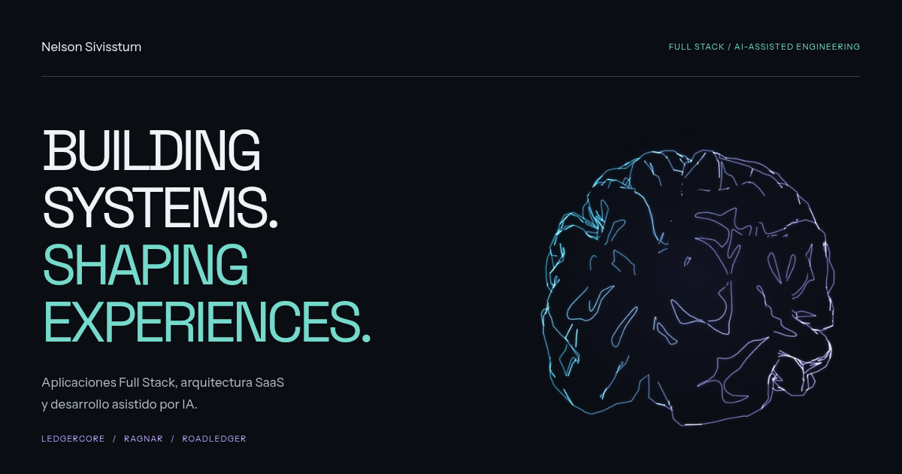

# Portfolio de Nelson Sivisstum

Mi portfolio de desarrollador full stack, en español y en inglés, con tema claro y oscuro.

[Ver el sitio](https://nelsonvis-portfolio.vercel.app/) · [English](https://nelsonvis-portfolio.vercel.app/en/) · [LinkedIn](https://www.linkedin.com/in/nelson-sivisstum-4777a32b4/)



> English summary: my developer portfolio. A static site generated with TypeScript, with a three.js scene on the home page (a particle brain you scroll into, then a 3D project carousel), text effects from React Bits and project videos rendered with Hyperframes. Spanish and English versions, light and dark themes.

## Qué hay en el sitio

- Una portada con mi nombre y un cerebro hecho de partículas. Al bajar, la cámara entra al cerebro, las partículas se abren en un túnel y aparece un carrusel 3D con mis tres proyectos.
- Un click en el proyecto del frente abre su detalle. Cada proyecto tiene además un caso de estudio completo.
- Una sección sobre cómo uso la IA para programar, sobre mí, el stack y el contacto.
- Sin WebGL, con movimiento reducido o sin JavaScript, el sitio se ve completo en 2D.

## Cómo está hecho

| Parte | Herramientas |
| --- | --- |
| Generador | TypeScript propio: `src/build.ts` arma ocho páginas HTML (cuatro por idioma) |
| Escena 3D | three.js, GSAP ScrollTrigger y Lenis |
| Efectos de texto | React Bits: VariableProximity, TextType y TextPressure |
| Videos | Hyperframes (composición en `video/`) |
| Tipografía | Anybody y Martian Mono, las dos con eje de ancho variable (OFL) |
| Publicación | Vercel |

Algunas decisiones:

- **El contenido vive en datos.** Los textos de cada idioma están en `src/content/es.ts` y `src/content/en.ts`, con el mismo tipo. Cambiar un texto no requiere tocar las plantillas.
- **El 3D es una mejora.** Todo el contenido está en el HTML. La escena se carga después y agrega la clase `is-3d`; si no puede, la página sigue en 2D.
- **El cerebro sale de una malla real.** Las partículas se generan a partir de la superficie cortical fsaverage5 que distribuye Nilearn (licencia BSD, ver `public/models/`).
- **Los símbolos de la sección de IA son propios.** Son `>_` y `</>` hechos con partículas, no los logos de las herramientas.

## Ejecutar en local

Requisitos: Node.js 20 o superior.

```bash
git clone https://github.com/nelsonvis3/myportfolio.git
cd myportfolio
npm ci
npm run dev        # compila y sirve en http://127.0.0.1:3000
```

No hay recarga automática: después de editar, corré `npm run build` y recargá el navegador.

## Estructura

```text
src/
  content/       Textos en español e inglés, datos del sitio y rutas
  render/        Plantillas: layout, home y caso de estudio
  three/         Escena 3D (cerebro, carrusel, símbolos de IA) y efectos de React Bits
  client.ts      Menú y cambio de tema en todas las páginas
  build.ts       Genera dist/ y empaqueta el JS con esbuild
  styles.css     Sistema visual en blanco y negro
  journey.css    Estilos de la home y de la escena 3D
public/          Imágenes, videos, fuentes, modelo del cerebro y CV
video/           Composición de Hyperframes para los videos de los proyectos
```

Para volver a renderizar los videos de los proyectos, seguí [video/README.md](video/README.md). Los CV que se descargan son `public/cv.pdf` y `public/cv-en.pdf` ([docs/cv/README.md](docs/cv/README.md)).

## Publicación

Vercel corre `npm run build` y publica `dist/`. `dist/` no está en el repositorio.

Para compilar con otro dominio:

```bash
SITE_URL=https://mi-dominio.com npm run build
```

## Licencia

El código del sitio tiene licencia MIT ([LICENSE](LICENSE)). Los textos, el CV y las capturas de mis proyectos no forman parte de esa licencia.

### Licencias de terceros

- Componentes de React Bits (MIT + Commons Clause) en `src/three/islands/reactbits/`, con su aviso en cada archivo.
- Fuentes Anybody y Martian Mono (SIL Open Font License) en `public/fonts/`.
- Malla cortical de Nilearn (BSD) en `public/models/`.
